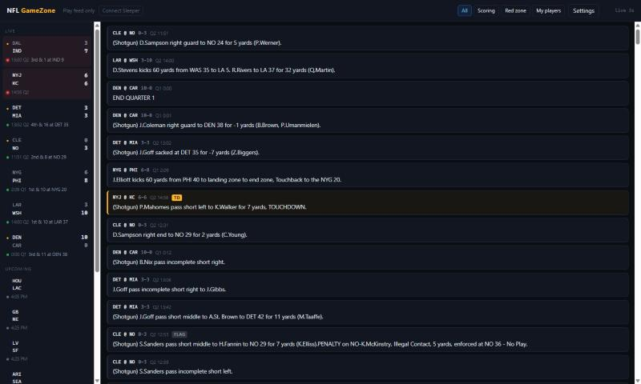

# NFL GameZone

A desktop version of Sleeper's SleeperZone: every play from every live NFL game
in one feed, with your Sleeper starters flagged and your fantasy matchup running
in the header — plus a live stats panel with your lineup, league-wide leaders
and a fantasy-scored box score for whichever game you click.

Static site. No build step, no server, no API key, no dependencies. Push it to
GitHub Pages and the browser talks to ESPN and Sleeper directly.



*Live Sunday slate. The fantasy overlay — starter badges and the matchup strip —
is not shown here because it renders a personal lineup; connect a Sleeper
account and it appears in the header and on matching plays.*

## Run it locally

```bash
python -m http.server 8765
```

Then open <http://localhost:8765>. Any static file server works; `file://` does
not, because ES modules are blocked there.

## Deploy to GitHub Pages

```bash
git remote add origin git@github.com:<you>/nfl-gamezone.git
git push -u origin main
```

Then **Settings → Pages → Source: Deploy from a branch → `main` / `(root)`**.

`.nojekyll` is already committed, which stops Jekyll from ignoring `js/`.

## How it works

| Source | Used for | Interval |
|---|---|---|
| `site.api.espn.com/.../scoreboard` | scores, clock, down/distance, red zone | 6 s |
| `sports.core.api.espn.com/.../plays` | play-by-play text | whole game once, then tail every 10 s |
| `api.sleeper.app/v1/league/.../matchups` | live fantasy points | 25 s |
| `site.api.espn.com/.../summary?event=` | box scores, scoring plays, win probability, drives | 30 s per live game |
| `site.api.espn.com/.../teams/{t}/roster` | player ID bridge | once a day |
| `api.sleeper.app/v1/players/nfl` | player names and positions | once a day |

Roughly **34 KB/s** late on a full Sunday slate, about 120 MB an hour, and the
`summary` poll is 75% of it:

| Poll | Measured | Rate on 14 games |
|---|---|---|
| scoreboard, 6 s | 13–21 KB gzip | ~3 KB/s |
| plays tail, 10 s each | 4.8 KB gzip | ~7 KB/s |
| `summary`, 30 s each | **49–59 KB gzip**, mean 55 | **~26 KB/s** |

The earlier figure in this file was 6–7 KB/s and 23 MB an hour, and `config.js`
described the summary as "~19 KB gzipped per game". Both were measured before
the box-score poller existed in its current form and against games that had
barely started; a summary grows all afternoon as drives accumulate, and five
finished Week 8 games average 55 KB. Nothing here costs money — ESPN is free
and unauthenticated — but the number was wrong by about 5×, so it is restated
rather than quietly corrected.

### Two things worth knowing

**Your matchup total is never computed here.** Sleeper's `matchups` endpoint
already returns live per-player points under your league's own scoring settings
(43 of them, in this case). Those numbers are read as truth, so the header
always agrees with the Sleeper app exactly.

The leaders board is the one place points *are* computed, because Sleeper only
reports on players rostered in your league and the board covers every player in
the NFL. That calculation is checked against Sleeper's own numbers rather than
trusted — see [Stats and scoring](#stats-and-scoring).

**Sleeper's `espn_id` field is not a usable player bridge.** It is populated for
only 221 of 864 active fantasy-relevant players — about 26%. Ja'Marr Chase,
Evan McPherson, Jaylen Waddle, Breece Hall and Brandon Aubrey all return
`espn_id: null`. Building on it looks like it works and then silently fails to
flag your best players.

So `js/bridge.js` pulls all 32 ESPN team rosters and matches on normalized
name + team + position, with `espn_id` as a fast path only. Measured on the
live slate: **2,509 of 2,567 ESPN athletes linked** (601 via `espn_id`, 1,908 via
name match), and **96 of 96 starters across all 12 league rosters resolved**.

Settings → Diagnostics runs that coverage check live and names any starter that
failed to link. If it ever says anything other than "all league starters
linked", the name matcher needs a new case — add it to the index in
`bridge.js`.

## Moving between weeks

The arrows beside the matchup in the header move the whole dashboard — feed,
rail, box scores and your matchup — to another week, and rewrite `?week=` so the
URL can be shared or reloaded. `[` and `]` do the same from the keyboard.

A switch tears down everything keyed by a game id, because a different week is a
different set of games and leaving the old plays behind would merge two weeks
into one feed. Alerts stay suppressed across the reload for the same reason they
are at boot: ingesting a week of finished plays would otherwise replay every
touchdown in it.

`?week=8` still works as a starting point, and `?seasontype=1|2|3` selects pre /
regular / post season. The regular season is 18 weeks; the playoffs are a
different `seasontype`, not a week past 18, so the arrows stop there.

**The matchup follows the week on screen.** It used to be set from Sleeper's own
`/state/nfl` `week`, which is the *transaction* week: from Tuesday it has already
rolled forward to a week with no results. That read as a 0.0–0.0 matchup beside a
finished slate, and made the scoring check compare this week's box scores against
next week's empty points — `0 of 146 exact`, with nothing actually wrong.
`display_week` is the field that holds the last week with results, but it lags
into a Thursday night game, so neither is right in both directions and the week
being displayed is.

## The season player table

Press `t`, or the table icon in the header, for a full-window sortable table of
every fantasy-relevant player — 835 of them through week 9 — scored under your
league's own settings, with ownership from your league's rosters. Your team and
the waiver wire sit in one list, so "who is the best free-agent running back"
is a position chip, an ownership chip and a sort.

Sort by any column. Search matches a name or a team. Scope to the whole season
or to the week the dashboard is on; selecting a week re-ranks by that week's
points while games, per-game and best stay season-wide, which is the comparison
worth having. Players on a bye are absent from a week rather than listed at
zero, because zero reads as "played and did nothing".


### My team and the free pool, two ways

A waiver decision is one question: *is anyone available better than the player
in this slot?* The ownership chips were mutually exclusive, so the table could
show your team or the free agents but never both, and the question had no
answer on one screen. There are now two arrangements of the same rows, because
the question has two shapes.

**Mine + FA** is a fifth ownership chip. It keeps your players and the free
pool and drops the other eleven rosters — the only players in the league you
cannot sign at any price. Sort by any column and anyone above one of yours is
an upgrade. This is the arrangement for browsing: *who are the best available
backs, and where do mine fall among them.*

**Compare** is a second mode, beside Table in the bar. Your lineup runs down
the left in Sleeper's own slot order — QB, RB, RB, WR, WR, TE, FLEX, K, DEF,
then the bench — each row carrying its points, per-game, and a green badge
showing how much better the best available player at that slot is. The right
column is that slot's free-agent board. Click any lineup row to change it.

```
MY TEAM                      Pts   PPG   Gap  │ BEST FREE AGENTS · RB
QB   Josh Allen            206.7  25.8  -5.1  │ 4g  Kyle Monangai   59.3  14.8  +7.0
RB   Devin Singletary       39.4   7.9  +7.0  │ 8g  RJ Harvey       67.4   8.4  +0.6
RB   D'Andre Swift         153.8  17.1  -2.3  │ …
```

The left column is the whole report: a negative gap means you already hold the
best there is at that slot, and the green ones are the roster spots worth
spending a waiver claim on. The badge is the only colour in the view.

A slot's eligible positions come from the slot itself, not from the player
standing in it — FLEX offers RB, WR and TE, `WRRB_FLEX` drops the tight end,
`SUPER_FLEX` admits the quarterback — so the board is what could legally fill
the spot. A bench slot has no position of its own and takes one from its
occupant. A rostered player with no stats row keeps his slot rather than
renumbering the ones below him, and if he is not in Sleeper's active-player
dictionary either, the row says so: not being on an NFL team is itself the
finding about that roster spot.

**Minimum games is a control, not a constant.** It starts at 3. One
thirty-point week puts a waiver flyer at the top of any per-game ranking, and
how much of a sample counts as evidence is a judgement about your own league
and your own risk appetite, not a number this code gets to pick for you. It
sits in the bar in compare mode and the meta line states whichever value is in
force.

Both sides are ranked by **season** points per game however the Pts column is
scoped, because a waiver claim is about the rest of the season rather than the
week just gone. When a week is selected the meta line says so.

### Fantasy points are a dot product

Sleeper publishes per-week stat files for every player, and names their fields
in the same vocabulary as a league's scoring settings — `rec`, `fgm_30_39`,
`def_td`, `pts_allow_7_13`. So league points are exactly:

```
points = Σ  stats[key] × scoring_settings[key]
```

Measured against the league's own `matchups` endpoint, which is what Sleeper
actually awarded: **1390 of 1390 player-weeks exact**, across all nine completed
weeks, team defences included.

| Week | 1 | 2 | 3 | 4 | 5 | 6 | 7 | 8 | 9 |
|---|---|---|---|---|---|---|---|---|---|
| Exact | 166/166 | 161/161 | 165/165 | 163/163 | 152/152 | 143/143 | 143/143 | 143/143 | 154/154 |

Fifteen lines replace every piece of scoring machinery for historical weeks.
There is also **no bridge in this path** — both sides are Sleeper ids, so none
of `bridge.js`'s 58 unresolved athletes can affect these numbers. Ja'Marr Chase,
the player whose null `espn_id` the bridge exists for, needs no special case here
at all.

### Season totals are summed from the weekly files

There is a season aggregate at `/stats/nfl/regular/2026`, and it is **not** used.
It lags by a whole game for whichever teams played most recently: measured
2026-11-10, 28 rows adrift, every one of them Minnesota or Buffalo, every one
last played in week 9. Josh Allen read 234 passing yards, a touchdown and an
interception short — 13.9 points of a 206-point season.

Summing the nine weekly files, each of which was checked against Sleeper, is the
only total that agrees with what the league actually awarded week by week. It
also makes games played exact and the weekly breakdown free.

### Games played is counted, not read

Both `gp` and `gms_active` exist on a stats record and neither is the number a
per-game average should divide by. Against a count of the weeks a player has a
stats row at all, over the 535 players who score more than a point: `gp` agreed
on **370**, `gms_active` on **474**. So games are counted here.

Every row that lacks `gp` entirely scores exactly 0.00, so nobody who matters is
affected by its absence — only by its disagreement.

### `players_points` is per roster-week, not a season total

Summing a player's `players_points` across the season looks like an obvious
check and is wrong: a matchup only carries the players on that roster that week,
so anyone picked up mid-season is undercounted. One player read 81.8 in the table
against 30.4 from that sum — he had been rostered in weeks 1, 7, 8 and 9 only.
The table's figure is his actual production. Compare per week, not per season.

### What it costs

| Call | Gzipped | When |
|---|---|---|
| `/stats/nfl/regular/2026/{week}` | 67 KB | once per week of the season, on first open |
| `/state/nfl` | 0.1 KB | once, cached 5 minutes |
| `/league/{id}/rosters` | 1.9 KB | already fetched for the dashboard |

About 600 KB on first open, which is why it loads when the view is first opened
rather than at boot — the live feed never needs any of it. Weeks before the
current one are final and cached for a week; the current one gets two minutes.

The raw payloads are never stored. Nine of them is 4.8 MB against a ~5 MB
`localStorage` cap, so each week is projected to `{ playerId: points }` the
moment it arrives — about 32 KB a week.

**The cache key carries a fingerprint of the scoring rules.** The files are
stored already scored, so an entry written under one set of rules is simply
wrong under another. Invalidating when a league connects cannot cover it: the
first connect races the first load, and switching leagues would serve the
previous league's points until something thought to clear them. Keying on the
rules means a change misses the cache and refetches. This was a real bug —
week 9 served points scored under the full-PPR defaults after the league had
connected — and the key is what fixed it.

## Layout

```
js/config.js    endpoints, intervals, team-abbreviation aliases
js/teams.js     the 32 franchises, baked in (see note below)
js/store.js     localStorage with TTL, failure-tolerant
js/state.js     one state object plus a minimal pub/sub
js/espn.js      scoreboard, play tail paging, team rosters, win probability, drives
js/sleeper.js   league, rosters, live matchup, slim player cache
js/bridge.js    ESPN athlete id  ->  Sleeper player id
js/poller.js    interval scheduler with exponential backoff
js/feed.js      cross-game merge, dedupe, filters, player follow, rendering
js/boxscore.js  slate-wide player stat table and leader ranking
js/scoring.js   fantasy points from stat lines, under league settings
js/season.js    Sleeper's weekly stat files, scored under the league's settings
js/players.js   the full-window season player table and the lineup-vs-free-agents compare
js/panel.js     the stats panel: My Team, leaders board, per-game box score + drives
js/rail.js      the game rail, with per-game starter counts
js/matchup.js   the header score strip
js/alerts.js    WebAudio chimes, flash, desktop notifications
js/main.js      boot and wiring
```

### Wide screens

The three columns did not grow together. The rail and the panel are fixed
widths and `.feed-list` is capped at 940px, so past about 1500px every extra
pixel landed as dead space on one side of the plays. Measured at 1920: a
1360px feed column holding a 940px list, with 80-character play text on a
**124-character measure** — roughly double a comfortable one.

Above 1600px the rail and panel take the extra width, the list is centred
rather than left-hugged, and the play text gets a measure instead of filling
whatever is there:

| at 1920px | before | after |
|---|---|---|
| rail / panel | 220 / 340 | 272 / 408 |
| dead space | 420px, all on the right | 145 left, 155 right |
| text measure | 124 characters | **85** |
| median play fills | 65% of a line | **94%** |

`76ch` produces that 85. A proportional font's average glyph is narrower than
its `0`, so `ch` units read about 12% wide for prose.

`js/teams.js` is generated rather than fetched because
`site.api.espn.com/.../teams` is the one ESPN path tested that omits
`Access-Control-Allow-Origin`, so a browser cannot read it. Every other
endpoint used here sends `*`.

## Stats and scoring

Clicking a game swings the right-hand panel to that game's box score, with every
skill-position and kicking line scored into fantasy points. The Leaders tab
ranks the whole slate across nine categories — fantasy points, passing, rushing
and receiving yards, receptions, targets, touchdowns, completions and kicking —
and cuts any of them by fantasy position: **All · QB · RB · WR · TE · FLEX · K · DEF**.

The position had to come from somewhere other than the obvious place. ESPN's
box-score summaries carry **no athlete position at all**: measured on a full
Week 8 slate, 0 of 892 stat rows had one, so the `pos` field the aggregator had
always written was always the empty string. The team rosters the bridge already
fetches do carry it, and on the same slate they resolve **891 of 892 stat rows,
and 266 of 266 players with fantasy points** — nobody falls through. They are
normalised with the bridge's own `normPos`, so the board and the bridge group
players identically rather than each holding an opinion (ESPN says `PK` and
`FB`; fantasy says `K` and `RB`).

Because of that the rosters now load *before* the Sleeper player dictionary:
positions are useful with no league connected, and the old order left them
blank whenever Sleeper was slow or unreachable.

### Two-point conversions

A two-point conversion appears in **no stat line at all**. A quarterback who
runs one in gains no rushing yard and no touchdown the box score will admit to,
so he scores two points the stat sheet cannot see. Diagnostics found it rather
than a hunch did: a finished slate read 132 of 134 exact, and both misses were
exactly 2.00 low — Jordan Love 34.18 against Sleeper's 36.18, Baker Mayfield
7.72 against 9.72. Both had run a conversion.

They live in the scoring play's parenthetical, the same complete whole-game
source field-goal distances come from. Scanning **104 games across weeks 3–9**
turns up exactly four forms and no others:

| Form | Seen |
|---|---|
| `<Passer> Pass to <Receiver> for Two-Point Conversion` | 22 |
| `<Rusher> Run for Two-Point Conversion` | 10 |
| `Two-Point Pass Conversion Failed` | 25 |
| `Two-Point Run Conversion Failed` | 2 |

A failure never carries a name and a success always does, so **requiring the
name is what separates them** — no "Failed" test is needed, and a fifth form
would be ignored rather than mis-scored. Sleeper pays the passer, the receiver
and the rusher separately, so all three are credited.

Like field goals the entry gives names and no athlete ids, so they are matched
back onto that team's own box-score rows by normalised name — scoped to one
roster, which is what makes the match safe. A conversion that finds no row is
two points nobody gets, so it logs a warning instead of reading quietly low.
On the slate above, none did.

### Team defences

A D/ST is not an athlete and has no stat line, so it has to be assembled. There
is no one place in the payload that holds it, and **every obvious shortcut is
wrong**. Each of these was measured on the full Week 8 slate before being
accepted or rejected:

| Count | Source | What was wrong with the obvious one |
|---|---|---|
| Sacks | the `defensive` group's per-player `sacks`, summed | nothing — agrees with the opponent's team stat on 10 of 10 team-sides, and handles half-sacks |
| Takeaways | the **opponent's** team-stat `fumblesLost` | summing the team's own `fumblesRecovered` disagreed on **3 of 10** team-sides (GB 2 vs 1, TEN 3 vs 1, DAL 3 vs 1): it counts a player falling on his own team's fumble, which is not a takeaway |
| Defensive TDs | `scoringPlays`, by the play's type text | both alternatives fail. Summing player rows double-counts a pick-six, which appears in the `defensive` group **and** the `interceptions` group — JAX read 26 against Sleeper's 20. The team-stat `defensiveTouchdowns` is wrong too: **LV reads 2 having scored none**, its only non-offensive score being a 95-yard kickoff return |
| Safeties | `scoringPlays` with type `SF` | they are in no stat group at all — the same reason field-goal distance comes from here |
| Points allowed | the opponent's score | — |
| Yards allowed | the opponent's `totalYards` | only scored by leagues that set the `yds_allow_*` keys; an absent key contributes nothing rather than falling back to a guess |

With those, **all 10 defences anyone in the league had started in Week 8 matched
Sleeper to the cent** — CIN 4, MIN 7, NYJ −3, PIT 19, TB 18, JAX 20, LAR 10,
DEN 2, NE 8, SEA 2.

The rows are keyed by team abbreviation, which is not a convenience: that is
already Sleeper's own player id for a D/ST, so a defence needs no bridge entry
and Diagnostics checks it against Sleeper exactly the way it checks a receiver.
Every leaders category other than fantasy points and touchdowns reads a
skill-position stat line, so a defence scores 0 there and drops off those boards
on its own.

Two things it still cannot see, and the Leaders board says so under the DEF
board rather than quietly reading low:

- **Blocked kicks.** In no stat group, and not a scoring play. Week 8 contained
  none, so there was no sample to verify a detector against.
- **Return touchdowns are left out.** No league member started a team whose
  returner scored, so whether Sleeper credits a kick- or punt-return touchdown
  to the D/ST could not be checked. Leaving them out is what the 10 verified
  defences support; adding them on a guess is what produced the LV error above.

Points come from **box-score aggregates, not play text**. A box score is already
reconciled: yards, receptions and touchdowns are single numbers, so mapping them
to scoring settings is arithmetic. Parsing the same information out of play
narrative means re-deriving totals that ESPN has already totalled, and getting
stat corrections wrong.

**Field-goal distance is the one thing a box score cannot give.** It reports
makes and attempts; most leagues, including this one, pay 3 points for a 25-yard
kick and 5 for a 52-yard one. The first implementation read distances out of the
play feed, where kicks read `N.Folk 31 yard field goal is GOOD` and carry a
participant tagged `kicker`. That was wrong, and the validation check caught it:
Evan McPherson scored 4 against Sleeper's 13. The feed only held a rolling tail
of each game, so any kick made before the page loaded was simply not in it.

The feed now pulls each game whole (see [The day's plays](#the-days-plays)), but
the fix stands on its own terms: distances come from `summary.scoringPlays`,
which covers the whole game, arrives in a payload already being fetched for box
scores, and does not depend on the play log being complete. Its field-goal entries carry
no athlete ID, so the kicker is matched by name against the team's kicking rows.
Misses need no distance at all, since `fgmiss` is flat: attempts minus makes is
exact.

**The scoring is checked, not assumed.** Settings → Diagnostics compares every
computed total against Sleeper's own number for that player, split by game
state:

```
scoring check vs Sleeper
  final games: 17/17 exact
  live games: 49/57 exact
```

Finished games are the real test, and they are what caught the last scoring
bug: on a finished slate the board read **132 of 134**, with both misses exactly
2.00 low and both quarterbacks. See [Two-point conversions](#two-point-conversions).
It now reads **134 of 134**.

In a live game the two sources are sampled seconds apart, so a player who just
gained yards reads higher here until Sleeper catches up.

A live gap is one play wide, which is not the same as small: a 60-yard catch
is seven points in PPR. Caught in the act during Week 9 — Denzel Boston read
10.1 here against Sleeper's 3.1, a 60-yard reception Sleeper had not credited
yet, and twenty seconds later Sleeper read 10.0. That is what sampling lag
looks like. A scoring bug would be a consistent offset that survived the
whistle, and none does.

Where no league is connected the board falls back to full-PPR defaults, so it
still shows something sensible.

## The fantasy layer

The app pulls a lot of fantasy data. For a long time it showed almost none of
it: 173 league players' live points and both full lineups sat in memory behind
two totals in the header.

**My Team** is the panel's default tab once a league is connected. It lists your
starters in Sleeper's own lineup order, each with live points and the state of
the game they are in — `Q3 9:51`, `Final`, or a kickoff time — plus the count
that matters most on a Sunday afternoon:

```
KEAGS POWDER PLAYBOOK                          75.2
2 yet to play
QB    Josh Allen        BUF @ MIN · 8:15 PM      0.0
RB    Devin Singletary  NYG @ PHI · Q3 10:47     3.2
WR    Ja'Marr Chase     CIN @ ATL · Final       31.5
...
```

Your opponent's lineup is listed underneath, which is the half of the matchup
the header never showed. Team defences resolve too: a Sleeper `DEF` slot is a
team abbreviation rather than a player, so it is matched to a game directly.

**Following a player** narrows the feed to one athlete across every game. Click
any row — a lineup slot, a leaders entry, a box-score line — and the feed shows
only their plays, matched on ESPN's `participants` rather than by searching the
text. A chip names who is being followed and clears it; a filter that silently
empties the feed with no visible cause is indistinguishable from a broken app.

**The game rail carries fantasy markers**: `★ 2` for your starters in a game,
`◆ 3` for your opponent's. The rail is the surface you scan to decide where to
look, and without these it said nothing about your team.

## The day's plays

Each game's play log is pulled **whole once, then tailed**. The tail alone is a
rolling window, so a game that kicked off before the page loaded contributed
only its last few plays: scrolling back through the day found nothing, and
anything derived from play text silently lost its history.

Measured on the Week 9 slate: the tail-only feed held **260 plays**, the full
pull holds **1,157**. Steady-state cost is unchanged — over 25 seconds of
polling, 14 tail requests and zero full pulls, since a game is only ever pulled
whole once. The one-time cost is about 37 KB gzipped per game.

Finished games are pulled too, so the morning slate is still in the feed when
you open the page in the evening.

### Which plays mattered

A play is tiered `score`, `key`, `note` or `log`, and the tier drives the
card's colour and weight. The first four rules are obvious — scoring plays,
turnovers, your starters, admin lines — and between them they cannot see a
fourth-down stop, a missed field goal, or a sack on third and goal. Those
decide games and look like nothing in a box score.

**Win probability is the fifth rule.** The `summary` payload the box-score
poll already fetches carries a `winprobability` array, one entry per play, and
its `playId` joins straight onto the play feed's own ids — measured **2,604 of
2,604** across a full Week 8 slate, which is the opposite of the `espn_id`
story below. A play that moves win probability by five points or more is
promoted to `key` and tagged with the number.

Measured over those 2,604 plays:

| | count | share |
|---|---|---|
| scoring plays | 120 | 5% |
| turnovers | 40 | 2% |
| **leverage only** (neither of the above) | **148** | **6%** |

So the rule roughly doubles the set of genuinely significant plays, entirely
from plays nothing else in `tierOf()` could reach. By type, the 148 are 64
receptions, 38 runs, 16 incompletions, 10 penalties, 10 sacks and **5 missed
field goals** — a missed kick being exactly the play a box score cannot see.

**Kickoffs are excluded,** which is why 148 and not 160. ESPN's entry for a
scoring play carries the number from *before* the score, so the jump lands on
whatever comes next, and what comes next is the kickoff: 12 of the first 160
were kickoffs, one a touchback wearing a 46% tag. The test is anchored
(`/^kickoff$/i`), so a *Kickoff Return Touchdown* still qualifies — one in
this slate swung 17%. Punts keep the rule too.

The **Big plays** filter shows `score` and `key`. The first cut was "anything
that is not the log tier", which measured 1,233 of 2,604 — 47%, which is not a
filter. The `note` tier is broad on purpose (every red-zone snap, every 20-yard
gain, every flag) and belongs in the feed's colour rather than behind a chip.
Score plus key is 496, or 19% of the slate; on a single game it is **18 plays
out of 172**, against 8 for Scoring alone.

### What you missed

Leaving the tab is the signal that you stopped watching. Coming back draws a
rule across the feed at the last play you saw, with a sticky chip that jumps
to it.

The count comes from the rendered list, not from `state.plays`. Those are
different numbers — one holds every play of every game, the other only what
the filters let through — and the first version said "30 plays" above 21
cards, which reads as a bug. Counting the cards above the line cannot disagree
with the line, whatever the filters are doing.

### Drives

The same `summary` payload carries `drives`, which is how the game actually
went in 25 lines rather than 197. The panel's game tab lists them newest
first, scoring drives highlighted. ESPN writes the `8 plays, 56 yards, 3:33`
description itself, so it is printed rather than rebuilt from parts that could
disagree with it.

### Keyboard

The filter chips are numbered left to right, so the order on screen is the
order on the keyboard and there is nothing to learn.

| Key | |
|---|---|
| `1`–`5` | All · Big plays · Scoring · Red zone · Mine |
| `j` / `k` | next / previous game in the rail |
| `g` | back to the whole slate |
| `p` | show or hide the stats panel |
| `t` | the season player table, and back |
| `[` / `]` | previous / next week |
| `Esc` | dismiss the panel while it overlays the feed |

Nothing fires while a field has focus or a dialog is open. `t`, `[` and `]`
work from either view; everything else steers the feed, which the table is not.

## Phones

The desktop layout is three columns. A phone gets one at a time, switched from
a bottom bar within thumb reach rather than a menu at the top of a tall screen:
**Games · Feed · Stats**. Tapping a game in Games filters the feed and moves
there, because that is what you tapped it for.

What the phone layout had to fix:

- **The breakpoint never applied.** `body.panel-closed main` is a desktop rule
  outside any media query, and it outranks a bare `main` inside one. Below
  820px the phone kept a 220px rail and a **155px feed**, which is why play
  text wrapped seven lines deep. Specificity, not the breakpoint, was the bug.
- **Chrome ate the screen.** Header plus the wrapped chip block came to 251px
  of 812 — 31% before a single play. Now 84px and one scrolling chip row; the
  feed gets 74% of the screen.
- **Held sideways**, a phone has 375px of height and the stacked header plus
  bottom bar took 40% of it. A short-viewport rule drops the brand, puts the
  score inline and shrinks the bar to recover it.
- The segmented filter is **moved** into the chip row rather than hidden.
  Dropping Scoring / Red zone / Mine on the device with the least screen would
  remove the feed's most useful controls exactly where they matter most.
- Phones keep **150 feed cards** rather than 400. The whole day stays in memory
  for filtering and stats; it is the DOM that is capped.

Between the phone breakpoint and 1180px the three columns stop fitting, so the
stats panel becomes an overlay and starts closed. That default was read as the
panel *vanishing*, for two reasons worth recording: the open state was never
persisted, so every reload shut it again whatever you had chosen, and the
header toggle carried no pressed state, which left a closed panel
indistinguishable from an app with no stats panel. The choice is now stored
(`gamezone:panelOpen`) and only the first visit gets the width default; the
button lights the same way a pressed chip does; and Escape dismisses the panel
while it is overlaying something. That Escape handler runs in the **capture**
phase on purpose — `main.js` also listens on `document` to dismiss its dialogs,
and in the bubble phase one Escape closed the settings dialog *and* the panel,
because the dialog was already hidden by the time the panel's check ran.

A phone is identified by shape, not width alone:

```css
@media (max-width: 700px), (max-height: 500px) and (max-width: 900px)
```

A narrow screen, or a short one that is not a desktop — which is how a phone
held sideways (812×375) reads. An iPad portrait (768×1024) is neither, so it
keeps the rail beside the feed with the stats panel overlaying. The same query
string lives in `main.js`; the two must stay identical.

Also handled: `env(safe-area-inset-*)` around the notch and home indicator,
16px on the one text input so Safari does not zoom the page and never zoom
back, `-webkit-text-size-adjust` so landscape does not inflate type, 38px
minimum on anything tappable, and dialogs that fill the screen instead of
floating in it.

## Bets

A bet tracker that reads the same box scores the leaders board does, so a leg
is scored off the actual stat line rather than off text in the feed. Paste a
slip, or type one in; each leg shows what it needs and how close it is.

```
2-leg parlay · FanDuel · +310                       ALL HIT
$20.00 → $82.00   2/2 legs
  ✓ CeeDee Lamb over 120.5 receiving yards   195 / 120.5 yds
  ✓ Chris Olave 5+ receptions                      6 / 5 rec
```

### Syncing from FanDuel and DraftKings is not possible

Neither book exposes a user's bets. There is no public API, no developer
programme, and no OAuth for account data — what the odds vendors sell is lines,
not anybody's bet history. The only route to a real sync would be driving the
books' internal endpoints with your login, which means handling sportsbook
credentials and breaking their terms, so this does not do that.

What it does instead is read a **pasted slip**. No credentials, nothing to
breach, and once the parser knows the shape it is about as quick. Every parsed
leg is shown for review before anything is saved, and anything it could not
read is listed rather than silently dropped.

The parser handles what both books write: `Over 39.5 Receiving Yards`, the
`40+` alt-line form, `Anytime Touchdown Scorer`, combined markets like
`Rushing + Receiving Yards`, `Tackles + Assists`, totals, and a bare
`Bengals -3.5`. Clipboard formats differ by app version, so if a slip of yours
does not parse, the fix is to paste it into an issue — the patterns live in one
table in `bets-core.js`.

### What it can track

Everything ESPN's box score carries, which is more than it sounds:

| | |
|---|---|
| Passing | yards, TDs, completions, attempts, interceptions, sacks taken |
| Rushing | yards, carries, TDs, longest rush |
| Receiving | yards, receptions, TDs, longest reception, targets |
| Combined | rush + rec yards, pass + rush yards |
| Scoring | anytime touchdown |
| Defence | tackles, solo tackles, sacks, TFL, passes defended, interceptions |
| Kicking | kicking points, field goals made, longest field goal |
| Returns | return yards |
| Game | spread, moneyline, game total, team total |

Two details that are easy to get wrong and are tested:

- **`40+` and `over 39.5` are not the same comparison.** The first means *at
  least* 40, the second means *more than* 39.5. They agree on integers and
  disagree on a whole-number line, so which one was meant is stored per leg.
- **An over can settle live; an under cannot.** Yards only go up, so clearing
  the line is decisive the moment it happens, while staying under is only known
  at the whistle. An under that has already been passed is marked dead rather
  than "at risk" — it is not coming back.

A parlay is alive only while every leg is, which is the whole reason to track
one: a dead leg kills it however well the rest are doing.

### A decided bet stops being recomputed

Settlement used to be derived fresh on every render, from the **current**
scoreboard. That quietly destroyed the history. A leg resolves through
`gameFor`, which looks the event up in `state.games`; once the week rolls over
the event is no longer there, so the leg reads `unknown` — a state that is
neither "dead" nor "done" — and the bet falls through to **open**. A bet won in
Week 8 read as still running in Week 10, forever, and the money summary went
with it: the stake went back to counting as live exposure instead of a
settled return.

So the moment a bet is decided *and* the games it depends on are over, the
settlement is written onto the record and read back from there. The rules:

- **Final means final.** An under already past its line is arithmetically dead
  and the books would settle it, but ESPN revises stat lines during a game and
  a wrong freeze is permanent — so it waits for the whistle.
- **One dead leg in a finished game freezes the whole bet**, whatever the other
  legs say, because a parlay cannot recover. A *win* needs every game home.
- **An unmatched leg never freezes.** With no game there is nothing to be sure
  about.
- A frozen bet is dropped from the athletes the poller watches: it has nothing
  left to learn.

It is a snapshot of the progress the card already draws, not a second source of
truth — the legs themselves are untouched. The logic lives in `bets-core.js`
with the rest of the settlement maths, so the push Worker and the page can
never disagree about it, and 25 of the suite's cases cover it.

### Alerts

Bet alerts ride the box-score poll, since that is where the numbers move. A leg
hitting or busting chimes and notifies; a leg crossing 90% of its line notifies
once, not on every carry. A six-leg parlay ticking at once is one buzz, not six.

Adding a bet mid-game never announces the yards that player already had — the
baseline is taken when the bet appears, not from zero.

## Phone alerts, and what iOS actually allows

The app is installable: `manifest.json`, a service worker, and an
`apple-touch-icon`, so Share → Add to Home Screen gives a real icon and a
full-screen app with an offline shell.

Notifications are the harder half, and the constraint is worth stating plainly:

- iOS delivers web push **only to a Home Screen web app**, from iOS 16.4. A
  Safari tab gets nothing.
- Web Push is **server-initiated by definition** — something must hold a VAPID
  private key and send to `*.push.apple.com`. A static host cannot.
- iOS supports **neither Background Sync nor Periodic Background Sync**, so an
  installed web app cannot wake itself to check either.

So GitHub Pages alone can never push. `worker/` is the answer: a Cloudflare
Worker on a one-minute cron that polls ESPN, evaluates bets with the same
`bets-core.js`, and sends. Free plan, about 16 subrequests a run against a
ceiling of 50. Setup is in [`worker/README.md`](worker/README.md). Until it is
deployed, the toggle stays off and says why rather than pretending.

The push carries **no payload**: encrypting one needs ECDH, HKDF and AES-GCM in
the sender, and gets silently dropped when wrong. An empty push needs only the
VAPID signature, and `sw.js` fetches the message. The signature is generated and
verified against its own public key in `tools/worker-test.mjs`.

The service worker is **network-first for same-origin**. A cache-first shell
would load faster, but this project lost time twice to a browser serving a stale
ES module while the file on disk was correct, so the cache is a fallback for
being offline rather than a shortcut when online.

## The iPhone lock screen

`ios/gamezone-widget.js` is a [Scriptable](https://scriptable.app) script that
puts the matchup on the lock or home screen. Scriptable runs JavaScript as a
real WidgetKit widget, so this needs no Mac, no Xcode and no Apple Developer
account. Setup is in [`ios/README.md`](ios/README.md).

It is deliberately **not** a play feed. Apple's WidgetKit documentation gives a
frequently viewed widget 40 to 70 refreshes a day — roughly every 15 to 60
minutes — and requires timeline entries about five minutes apart. The budget is
the system's. A widget showing "the latest play" would be showing a play from
somewhere in the last hour while looking current, which is worse than showing
nothing. So it shows what survives that cadence: your matchup total, how many
starters have not kicked off, live scores, and the newest play from each live
game as context. Tapping it opens this site, which is the real feed.

Two things shaped the code more than the layout did:

- **Memory.** The widget needs player names and teams, and Sleeper's
  `players/nfl` is **14.0 MB**. Fetched one position at a time it is 5.00 MB
  across six requests and, the number that matters, peaks at **2.1 MB** for a
  single parse. Even so a widget extension gets a fraction of an app's memory,
  so the widget prefers a stale map over rebuilding one and only builds from
  cold if there is nothing cached at all. Running the script once inside
  Scriptable after install does the build where there is room for it.
- **Text length.** A lock-screen line is about 34 characters; ESPN play text is
  routinely 120, and spends a third of that on things nobody glances at a phone
  to read. `compressPlay` strips the formation, the tackler in brackets or
  trailing parentheses, the penalty clause bolted on the end, and the long
  snapper — `"C.Smyth 48 yard field goal is GOOD, Center-Z.Wood,
  Holder-R.Wright"` is 66 characters and becomes 34. It also never compresses a
  play to nothing, which a text that is entirely a parenthetical
  (`"(Brandon Aubrey Kick)"`) otherwise did, leaving a bare `DAL-IND`.

Scriptable only exists on iOS, so `tools/widget-preview.mjs` and
`tools/widget-scenarios.mjs` stub its globals and run the real script file from
Node against the live APIs — the first printing every size as text and flagging
any line over its budget, the second forcing the four states a live Sunday never
reaches. That covers the data and every rendered string. It does not cover
layout; only the device answers that.

## Design notes

The feed pushes well over a thousand plays through on a Sunday and almost all
of them are a 4-yard run. The design problem is not making plays look good, it
is making the handful that matter findable among the ones that do not.

**Plays are tiered, not uniform.** Four levels, in `tierOf()`:

| Tier | What | Treatment |
|---|---|---|
| `log` | routine play | inline one-liner, no chrome, recessive text |
| `note` | red zone, penalty, 20+ yard gain | gains a surface |
| `key` | turnover, or one of your players | surface, accent rule, full-contrast text |
| `score` | touchdown, field goal | team-colour wash, larger text, score shown |

**Timeouts are dropped.** Measured over a full game, 26 of 174 plays are
`Official Timeout`, `Timeout` or `Coin Toss` — 15% of the feed, and
"Official Timeout at 11:12" tells a viewer nothing. Clock markers like
`END QUARTER 1` are kept but forced to `log`, since field position should not
promote them.

**Punts and kickoffs are exempt from the big-gain rule**, because they travel
40–60 yards by definition and would otherwise all be promoted.

**The running score is hidden on routine plays.** It appears on every line
otherwise, which is pure repetition — the rail already shows it.

**Team colour instead of logos.** ESPN's logo assets are ~130 KB each and the
CDN ignores resize parameters, so 32 of them would be about 4 MB. A colour bar
in the rail and a coloured abbreviation on each play give the same at-a-glance
orientation for nothing. Many NFL primaries are near-black (`CHI #0b1c3a`,
`BAL #241773`) and invisible on a dark surface, so `js/teams.js` lifts
lightness in HLS space while preserving hue. Mixing toward white instead
destroys identity — a first pass turned Buffalo pink.

**Contrast is measured, not eyeballed.** All three text steps clear WCAG AA on
both background and surface (15.6:1, 7.1:1, 4.9:1). An earlier `--fg-3` of
`#626b7b` came in at 3.4:1, which fails for body text — and routine play text
is body text.

Motion respects `prefers-reduced-motion`. Filters and game rows are real
buttons carrying `aria-pressed`; the feed is an `aria-live="polite"` region so
new plays are announced without stealing focus.

## Known limitations

- **About 30 seconds behind the broadcast.** Measured against play `wallclock`.
  ESPN's public feed is not a low-latency wire. Sleeper will feel similar.
- **Undocumented endpoints.** ESPN publishes no public API and offers no SLA.
  These paths can change without notice; parsing here is defensive throughout.
- **Sleeper's API is free for non-commercial use only.** Personal dashboard is
  fine. Do not ship this as a product.
- **Desktop notifications need the tab open**, and the browser's permission.
  A static host cannot push. If the browser has blocked notifications for the
  site, the toggle refuses to turn on and says so; the grant has to be made in
  the browser's own site settings.
- **Audio needs one click first.** Browsers block WebAudio until a user gesture.
- **A team defence misses blocked kicks and return touchdowns.** Everything
  else matched Sleeper exactly on the Week 8 slate; those two had no sample to
  verify against. See [Team defences](#team-defences).
- **Live fantasy points run slightly ahead of Sleeper's.** The box score updates
  before Sleeper's tally does. The two agree exactly once a game is final.
- **The season table shows the top 400 rows of any sort.** 835 players at eight
  cells each is twice what the capped play feed holds, and the useful part of a
  sort is its top. The count says so, and search and the chips reach past it.
- **A week that has not been played is absent from the season table.** Week 10
  returned zero stat records on the Monday before it began, so the table stops
  at `display_week`. Whether a weekly file fills in *during* a Sunday has not
  been measured — the live feed and the stats panel are what cover an afternoon
  in progress, and they come from ESPN rather than from these files.

## Privacy

Your Sleeper username, your settings and your bets live in this browser's
`localStorage`. They are never committed, and nothing goes anywhere except
Sleeper's and ESPN's own public APIs.

Two things to know if you switch on phone alerts:

- Turning them on sends your **bets** and your push subscription to the Worker
  you deployed, because it has to evaluate them to know when to buzz. That is
  your own Cloudflare account, not a third party, and it holds nothing else —
  no Sleeper account, no league, no play history.
- Everything else stays local. With phone alerts off, nothing leaves the
  browser at all.

Your sportsbook credentials are never involved, because nothing here logs in to
a sportsbook. Pasted slips are parsed in the browser.

The VAPID private key is written to a gitignored file by the key generator,
goes straight into a Cloudflare secret, and is never printed or committed. Only
the public key is in the repository, which is what it is for.
